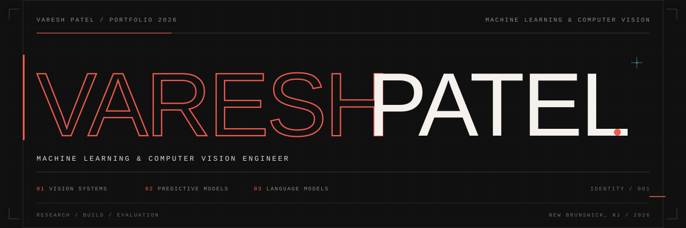
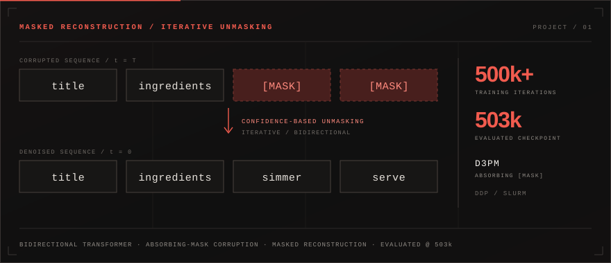
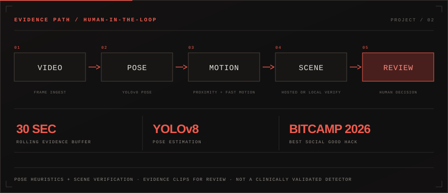
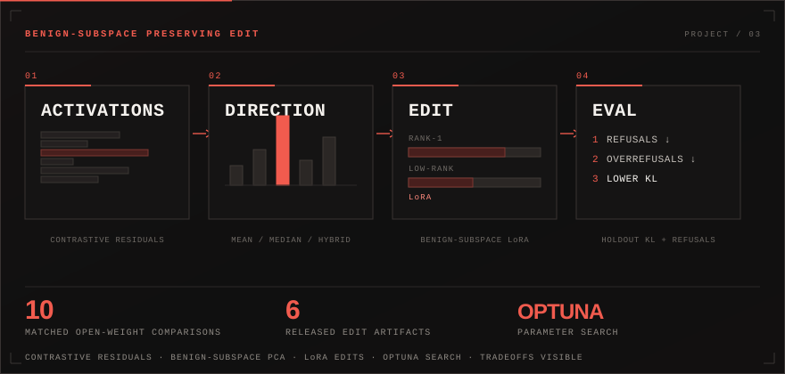

# Making data make sense.

**Varesh Patel** · Machine Learning & Computer Vision Engineer

I build and evaluate machine-learning systems — from diffusion language models and computer vision to practical AI applications and developer tooling.

Research-minded and product-obsessed: I care about evidence, evaluation, and the gap between a model that works and a tool people trust.

[Portfolio](https://www.initvaresh.com/) · [Résumé](https://www.initvaresh.com/resume.pdf) · [LinkedIn](https://www.linkedin.com/in/vareshpatel/) · [Email](mailto:workmailvaresh@gmail.com)

M.S. Computer Science, Rutgers University · expected May 2027 · New Brunswick, NJ

---

## Selected work

ENGINEERING / FLAGSHIP SYSTEMS

### 01 — DiffuLLM

**Training a Diffusion Language Model From Scratch**

A from-scratch discrete diffusion language model, trained and evaluated as an alternative to left-to-right text generation.

  

**Evidence** — Bidirectional Transformer · D3PM-style absorbing-mask corruption · masked-only cross-entropy · confidence-based iterative unmasking · PyTorch Distributed Data Parallel on SLURM · 500k+ training iterations.

**Evaluation** — The selected checkpoint (`best_step503000.pt`) stays coherent on short and medium recipe completions; longer generations show repetition, malformed control tokens, and drift. The comparison table also references a separate 1.2M-step run, so 503k is the checkpoint cited here. The comparative study includes two independently built SEDD systems by collaborators.

[Repository](https://github.com/Haadesx/Diffusion-Model) · [Case study](https://www.initvaresh.com/projects/diffullm) · [Report](https://github.com/Haadesx/Diffusion-Model/blob/main/report.pdf)

### 02 — CareWatch / EyeQ

**Computer Vision for Human-in-the-Loop Safety Review**

A human-in-the-loop safety prototype that turns pose and scene signals into short evidence clips for review — not an automated abuse detector.

  

**Evidence** — YOLOv8 pose estimation · proximity and fast-motion heuristics · scene verification · rolling 30-second evidence capture · SQLite event logging · React review dashboard · iOS guardian client.

**Contribution** — Hackathon team build; my work spanned the pose-heuristic pipeline, evidence capture, and review workflow, while teammates built the surrounding app and iOS client.

**Recognition** — Bitcamp 2026 Best Social Good Hack, verified on Devpost. A staged prototype, not a validated detector: no precision, recall, sensitivity, or false-positive figures are published, and a scan or alert is evidence for human review — never proof of abuse.

[Repository](https://github.com/Haadesx/EyeQ) · [Case study](https://www.initvaresh.com/projects/carewatch) · [Devpost](https://devpost.com/software/eyeq-0c8wdl)

### 03 — ICONOCLAST

**Targeted LLM Representation Editing and Evaluation**

A Python framework that measures the utility cost of changing refusal behavior in open-weight language models, instead of treating refusal removal as a single number.

  

**Evidence** — Contrastive residual activation analysis · per-layer direction estimation · benign-subspace preservation · LoRA edits · Optuna parameter search · holdout evaluation · 10 matched open-weight comparisons · 6 edited-model artifacts released on Hugging Face.

**Evaluation** — The repository's selection rule — fewer refusals, then fewer overrefusals, then lower KL — favors ICONOCLAST in all ten matched comparisons, with lower KL in eight. The tradeoffs stay visible: Falcon 3 is a behavior win but a KL outlier (6.1448 vs 0.1648), and Yi-1.5 has lower KL under the HERETIC baseline. This is optimized holdout benchmarking, not broad statistical confirmation or a universal-superiority claim.

[Repository](https://github.com/Haadesx/Iconoclast) · [Case study](https://www.initvaresh.com/projects/iconoclast) · [Model artifacts](https://huggingface.co/HaadesX)

---

## Recent applied AI

APPLIED SYSTEMS / HACKRU 2026

### MedCheck — OCR-first medication-label verification

An OCR-first verifier for caregiver medication safety: it checks whether a bottle matches a tracked prescription before a dose is logged. Extracted fields carry confidence and source metadata, a vision-language model is escalated to only when OCR is uncertain, and the caregiver explicitly confirms before anything is recorded.

**Architecture** — YOLO11n bottle detection → RapidOCR multi-frame extraction → structured fields with confidence and provenance → conditional Qwen3-VL escalation → explicit human confirmation → backend-owned dose and inventory rules.

**Boundaries** — I originated and directed the build; teammates and agent-assisted implementation contributed parts of the codebase, and the repository records that split. A label scan is evidence about a bottle, not proof of ingestion. There is no clinical validation, and this is not a clinical decision system.

[Repository](https://github.com/Haadesx/HackRU26) · [Case study](https://www.initvaresh.com/projects/medcheck)

---

## More engineering

SYSTEMS / TOOLING / INFERENCE

- **[Zypher EdgeAI](https://github.com/Haadesx/Zypher-EdgeAI-Demo)** — Zephyr RTOS and TensorFlow Lite Micro gesture inference on Cortex-M with CMSIS-NN. Runs in QEMU against mock sensor data, with CI smoke tests and a documented inference-thread stack-overflow debug.
- **[Crucible](https://github.com/Haadesx/Crucible)** — a sandboxed adversarial evaluation harness for AI agents: deterministic scoring, policy enforcement, and fake tools. An offline demo, not a production security product.
- **[lootqdm](https://github.com/Haadesx/lootqdm)** — a published Python training-loop toolkit on PyPI with PyTorch and Keras integrations, run profiles, and tests.
- **[WebGPU Edge AI](https://github.com/Haadesx/WebGPU_AI)** — a collaborative 16-prompt benchmark comparing browser-local quantized inference with cloud-hosted inference across latency, throughput, memory, and output quality.

---

## Experience

PROFESSIONAL / IN PRACTICE

**AI & Software Development Intern** — Impruvon Health · Summer 2026

Typed FastMCP tooling — nine tools over operational and transformed HL7 queries · authenticated REST integrations and normalized vendor responses · multi-location analytics · Playwright-recorded workflow demos.

**AI Intern** — Foundation for Ecological Security · 2025

IBIS 2.0: bird-species detection and classification across ~710 GB and ~1,150 species, with a two-stage pipeline at ~79% validation accuracy and researcher-facing Gradio and CLI workflows.

**AI Intern** — Arcascope · 2024–25

Wearable-data fatigue modeling with ordinal regression and CORAL losses; MAE reduced from 1.17 to 0.25 (~78%) across ~20 evaluated iterations.

**Campus Ambassador** — Adobe · 2025–2026, concurrent

Workshops and technical content for the Rutgers community.

EDUCATION — M.S. Computer Science, Rutgers University (expected May 2027, GPA 3.98/4.00) · B.Tech Computer Science & Design, G.H. Patel College of Engineering and Technology (2025)

---

## Research & publications

PEER-REVIEWED / PROCEEDINGS

1. **OpenPose, PoseNet and MoveNet: the evolution of deep learning methods in yoga pose classification** — Springer / ICDAM 2025 · Shah, Patel, Joshi · [DOI](https://doi.org/10.1007/978-3-032-02949-2_2)
2. **Machine learning-based hand gesture recognition for immersive gaming** — IJIRMF 2024, NOBCON proceedings · Varesh Patel · [Proceedings](https://www.ijirmf.com/wp-content/uploads/NOBCON-2024-min.pdf#page=17)
3. **Emotion-aware music recommendations: custom CNN vs VGG16 vs InceptionV3** — IEEE FMLDS 2024 · Varesh Patel, Khyati Mehta · [DOI](https://doi.org/10.1109/FMLDS63805.2024.00092)

---

## Outside engineering

BEYOND THE CODE / COMPETITIVE SWIMMING

**Two decades in the water.** Swimming since age three, competing since 2012, repeated district-level wins with progression to state competition, a state-level 200m Individual Medley medal in 2015, and university aquatics representation in 2023–24. It is the part of my life that has nothing to do with engineering — and it still shapes how I work: long feedback loops, technical repetition, and patience.

[Read the swimming story ↗](https://www.initvaresh.com/about#swimming)

---

The portfolio is the editorial presentation. This GitHub account is the inspectable engineering record.

[Portfolio](https://www.initvaresh.com/) · [Résumé](https://www.initvaresh.com/resume.pdf) · [LinkedIn](https://www.linkedin.com/in/vareshpatel/) · [Email](mailto:workmailvaresh@gmail.com) · [GitHub](https://github.com/Haadesx)
